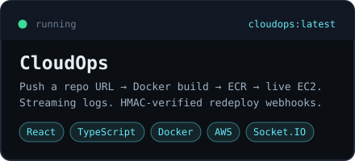
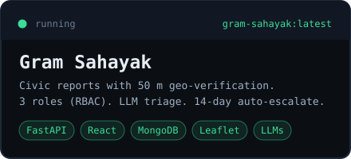
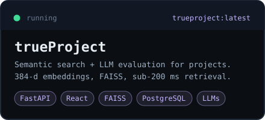
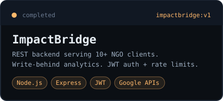

<div align="center">



<br/>

[`portfolio`](https://yashvanth.pages.dev) &nbsp;·&nbsp; [`linkedin`](https://linkedin.com/in/yashvanthmu) &nbsp;·&nbsp; [`github`](https://github.com/Yashvanth-7353) &nbsp;·&nbsp; [`email`](mailto:yashavanth.mu870@gmail.com)

</div>

<br/>

### `systems & production projects`

<table>
  <tr>
    <td width="50%"><a href="https://github.com/Yashvanth-7353/CloudOps"></a></td>
    <td width="50%"><a href="https://github.com/Yashvanth-7353/Gram-Sahayak"></a></td>
  </tr>
  <tr>
    <td colspan="2" align="center">
      <a href="https://github.com/Yashvanth-7353/trueProject"></a>
    </td>
  </tr>
</table>

<br/>

### `architectural specs`

| Project | What It Solves | Engineering Highlights | Core Stack |
| :--- | :--- | :--- | :--- |
| [**CloudOps**](https://github.com/Yashvanth-7353/CloudOps) | One-click Git-to-cloud deployments | Child-process log streaming over Socket.IO; auto-provisions EC2 via AWS SDK; HMAC-SHA256 signed redeploy webhooks | React, Node.js, Docker, AWS EC2/ECR, Socket.IO |
| [**Gram Sahayak**](https://github.com/Yashvanth-7353/Gram-Sahayak) | Verified civic infrastructure reporting | 50m Haversine anti-spoof geofencing; 3-tier JWT RBAC (citizen/contractor/official); LLM grievance triage + 14-day SLA escalation | FastAPI, React, MongoDB, Leaflet, OpenRouter LLMs |
| [**trueProject**](https://github.com/Yashvanth-7353/trueProject) | Automated academic project matching & review | 4-phase ML pipeline with 384-d dense embeddings; FAISS sub-200ms vector retrieval; fact-grounded rubric evaluation | FastAPI, React, FAISS, PostgreSQL, Transformers |

<br/>

### `work experience`

<table>
  <tr>
    <td width="48%" valign="top">
      
    </td>
    <td width="52%" valign="middle">
      <b>Web Development Intern</b> &nbsp;·&nbsp; <code>Mar 2026 – Jun 2026</code><br/>
      <sub>ImpactBridge · Early-stage startup serving 10+ NGO clients</sub>
      <br/><br/>
      • Built RESTful backend microservices for NGO onboarding, donations, and events using <b>Node.js</b> &amp; <b>Google APIs</b>.<br/>
      • Engineered an in-memory <b>write-behind analytics pipeline</b> with threshold persistence, cutting datastore write pressure.<br/>
      • Hardened API reliability and security via <b>JWT authentication</b>, rate limiting, and centralized error handling.
    </td>
  </tr>
</table>

<br/>

### `technical stack`

```yaml
languages:  [C++, Python, TypeScript, JavaScript, SQL]
backend:    [FastAPI, Node.js, Express.js, Socket.IO, REST APIs, JWT]
cloud-ops:  [AWS (EC2 · ECR · S3), Docker, Linux, Git / GitHub]
data-ai:    [FAISS Vector DB, MongoDB, PostgreSQL, Sentence Transformers, LLMs]
frontend:   [React.js, Tailwind CSS, HTML5, CSS3, Leaflet.js]
```

<br/>

### `proof of work & honors`

- 🏆 **National Finalist — Hackfest @ NMAMIT**: Top 5 out of 60+ teams in a 36-hour national hackathon
- 🥇 **Big Data Computing (NPTEL)**: Elite + Gold Medal (Top 5% Topper with 91% score)
- 🥈 **Data Science for Engineers (NPTEL)**: Elite + Silver Medal (81% score)
- ⚡ **LeetCode**: 300+ problems solved across arrays, graphs, trees, and dynamic programming
- 🎓 **RV College of Engineering**: B.E. in Information Science & Engineering (CGPA: 8.77 / 10)

<br/>

---

<div align="center">
  <sub>Open to Software Developer roles · <a href="mailto:yashavanth.mu870@gmail.com">Let's talk</a></sub>
</div>