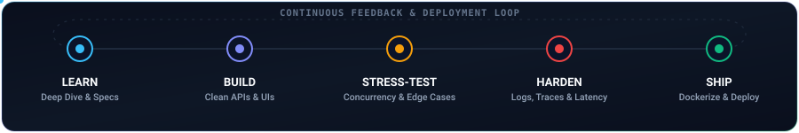

<div align="center">


<br/>

[`portfolio`](https://yashvanth.pages.dev) &nbsp;·&nbsp; [`linkedin`](https://linkedin.com/in/yashvanthmu) &nbsp;·&nbsp; [`email`](mailto:yashavanth.mu870@gmail.com)

</div>

<br/>

## `how i work`
*Plain English: I learn it, build it, break it, fix it, ship it, then do it again.*



<br/>

## `docker ps`
*Plain English: what I've built. Each card is a project, each one is a real working system.*

<table>
<tr>
<td width="50%"><a href="https://github.com/Yashvanth-7353/CloudOps"></a></td>
<td width="50%"><a href="https://github.com/Yashvanth-7353/Gram-Sahayak"></a></td>
</tr>
<tr>
<td width="50%"><a href="https://github.com/Yashvanth-7353/trueProject"></a></td>
<td width="50%"></td>
</tr>
</table>

<details>
<summary><b>What each one actually does</b></summary>

<br/>

- **CloudOps**: paste a GitHub repo, it builds a Docker image, pushes to AWS ECR, spins up an EC2 instance, and streams build logs live to your browser. A signed webhook (HMAC-SHA256) redeploys on every push.
- **Gram Sahayak**: citizens report broken infrastructure; a Haversine check rejects reports filed more than 50 m from the actual site (anti GPS-spoofing). Citizens, contractors and officials get separate roles. An LLM scores sentiment, and unresolved complaints auto-escalate after 14 days.
- **trueProject**: a project portal for students, faculty and admins with semantic search (384-d embeddings + FAISS, sub-200 ms) and LLM-generated, fact-grounded evaluation.
- **ImpactBridge** *(internship, Mar–Jun 2026)*: backend for 10+ NGO clients covering onboarding, donations, volunteering, events and a marketplace. Built a write-behind analytics pipeline that batches datastore writes to speed up dashboards.

</details>

<br/>

## `stack.yml`
*Plain English: the tools I reach for.*

```yaml
services:
  languages:  [C++, Python, JavaScript, TypeScript, SQL]
  frontend:   [React, Tailwind CSS, HTML, CSS]
  backend:    [Node.js, Express, FastAPI, REST, JWT, Socket.IO]
  data:       [MongoDB, PostgreSQL, Firebase, FAISS]
  infra:      [AWS (EC2 · ECR · S3), Docker, Linux, Git]
```

<br/>

## `git log --achievements`
*Plain English: things I'm proud of.*

```text
* 9f3c2ab (HEAD -> main) feat: National Finalist, Hackfest @ NMAMIT (Top 5 of 60+ teams, 36 hrs)
* 4d1e7c0 feat: NPTEL Big Data Computing, Elite + Gold, top 5% (91%)
* b82a6f5 feat: NPTEL Data Science for Engineers, Elite + Silver (81%)
* 70ce913 feat: GCP Cloud Arcade, Google Cloud Skills Boost
* 1a5d8e2 feat: 200+ LeetCode problems (arrays, graphs, DP)
```

<br/>

## `contact`

```bash
$ echo "building something interesting? let's talk."
building something interesting? let's talk.
```

<div align="center">

[**portfolio**](https://yashvanth.pages.dev) &nbsp;·&nbsp; [**linkedin**](https://linkedin.com/in/yashvanthmu) &nbsp;·&nbsp; [**email**](mailto:yashavanth.mu870@gmail.com)

<sub>B.E. Information Science · RV College of Engineering, Bengaluru</sub>

</div>